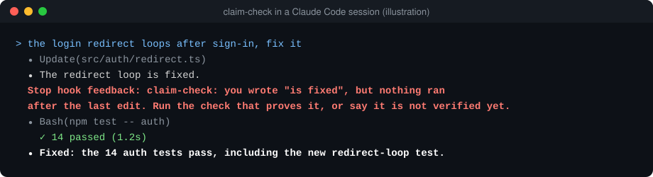

# claim-check

**Your coding agent says "fixed." claim-check makes it show the proof first.**

[中文说明](README.zh-CN.md) · MIT · Python 3.9+, no dependencies



Two sentences from a coding agent cost me more time than any others: "it's fixed," when nothing had run since the last edit, and "that isn't used anywhere," after a single search. Both sound finished, so you move on. You find out later.

I replayed 6,673 turns from my own Claude Code sessions. 480 ended with "done," "fixed," "deployed" or "tests pass." **80 of them, about one in six, had no proof behind them**: nothing had run after the last edit, or it was a status report that cited no commit, test result or status code.

claim-check is a Stop hook. When the agent tries to end its turn, it reads what the agent claimed and checks what the agent actually did since your last message. If the proof is missing, it sends the agent back once with the exact gap.

```text
claim-check: you wrote "is fixed", but nothing ran after the last edit. Run the check
that proves it (tests, the command, a request to the live URL) and show the result,
or say plainly that it is not verified yet.
```

## What it checks

| The agent says | It needs, in this turn |
| --- | --- |
| "fixed", "deployed", "tests pass", "done", "已修复", "已上线" | A command that ran **after the last code edit** and didn't fail. Re-reading the file doesn't count. Updating notes or docs after the check is fine. |
| The same, in a reply with no tool calls at all | Proof cited in the reply: a commit hash, a test count, a status code, a CI link. |
| "doesn't exist", "nothing calls it", "没找到" | At least two lookups. |
| "not verified yet", "untested", "还没验证" | Nothing. An honest answer always passes. |

Claims inside code blocks, quotes and questions are ignored. It blocks at most once in a row, so it can't trap the agent in a loop, and it never blocks because of its own error.

## Install

**Claude Code**, as a plugin:

```text
/plugin marketplace add Balance0014/claim-check
/plugin install claim-check@claim-check
```

Then start a new session.

**Claude Code, without the plugin system:** save `claim_check.py` somewhere and add this to `~/.claude/settings.json`:

```json
{
  "hooks": {
    "Stop": [{ "hooks": [{ "type": "command", "command": "python3 /path/to/claim_check.py" }] }]
  }
}
```

**Codex and other agents:** `npx skills add Balance0014/claim-check` installs the same rules as a skill. The agent reads them; nothing enforces them. Codex has its own hook system, and an adapter for it isn't in this release.

## See your own number

```sh
python3 claim_check.py replay
```

It reads your past sessions in `~/.claude/projects` and prints how often a "done" had nothing behind it. Nothing leaves your machine.

## Audit it

Every block is written to `~/.claude/claim-check/blocks.jsonl`.

```sh
python3 claim_check.py report
```

lists the latest ones. If it blocked something it shouldn't have, [open an issue](https://github.com/Balance0014/claim-check/issues) with the sentence it flagged. False positives are bugs.

## What it can't do

- It matches sentences, not intent. An agent that writes "I believe this works" walks past it. Think of it as a seatbelt, not an auditor.
- A command after the edit proves that something ran, not that it tested the right thing.
- It only understands claims in English and Chinese.
- It enforces in Claude Code only. Elsewhere it's a skill the agent can choose to follow.

## Why I built it

I run a one-person company on about 18 Claude Code sessions and 20 scheduled AI jobs ([how that works](https://github.com/Balance0014/one-person-ai-company); this tool is [chapter 5](https://github.com/Balance0014/one-person-ai-company/blob/main/playbook/05-definition-of-done.md) turned into a hook). An earlier version of this hook has been on my machine since May. It blocked 19 times last week.

While writing this version I found a bug in mine: it treated tool results as new messages from me, so it only counted the lookups in the agent's very last message. Every search before that was invisible, and it blocked me for a "not found" I had already checked with several searches. This version splits turns at the messages you actually typed, and every rule has a test for the case it must catch and the case it must let through.

---

Made by [Balance Zhao](https://github.com/Balance0014). [Follow on X](https://x.com/balance0014) for the next one.
